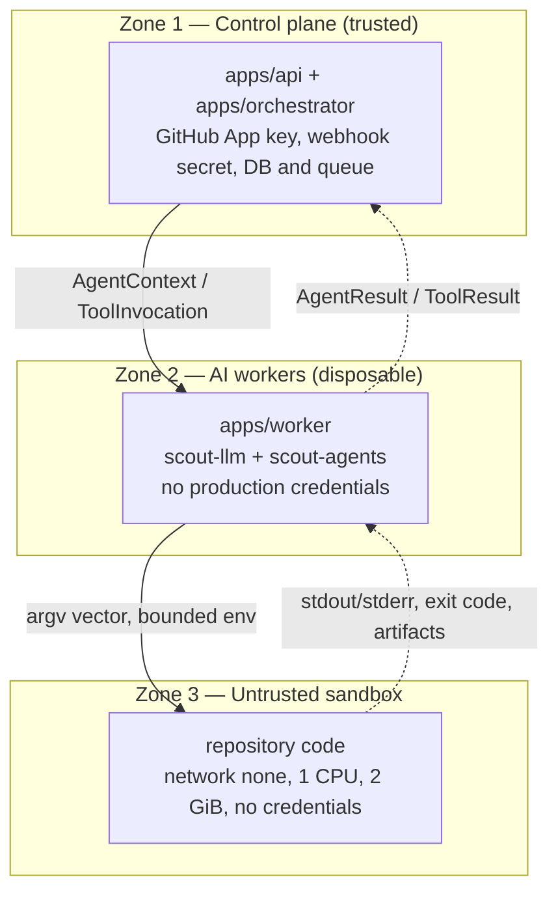
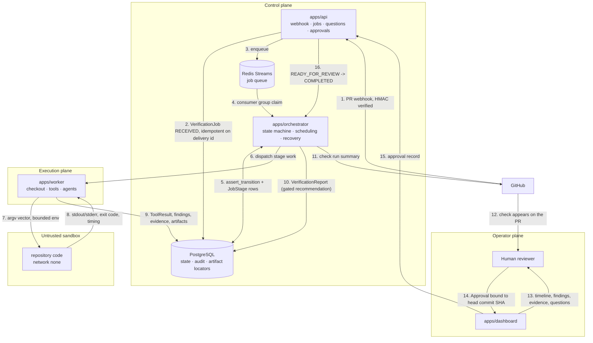
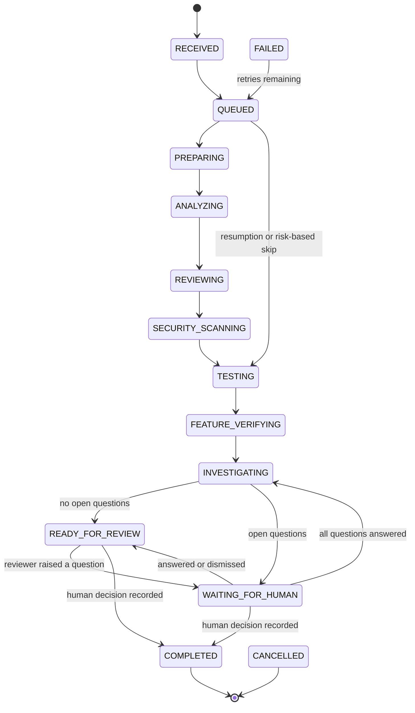
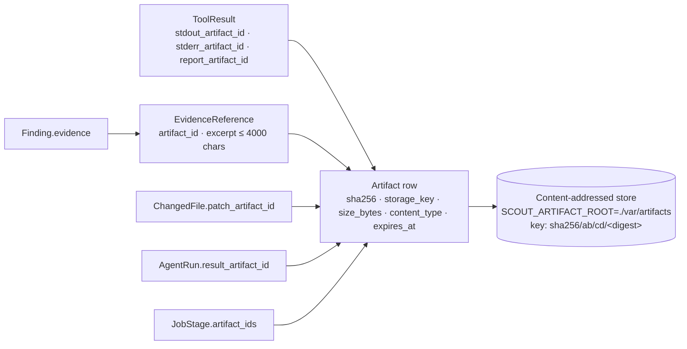

# Scout Architecture

> **AI investigates and recommends. Deterministic systems verify. Humans authorize.**

Scout verifies GitHub pull requests. It watches PR events, creates a verification job, analyses the
repository, runs deterministic engineering checks in an isolated sandbox, applies AI agents for
contextual analysis, verifies the stated feature against acceptance criteria, records the evidence
behind every conclusion, and produces a structured verification report for human review.

This document is the authoritative system design. Vocabulary is taken verbatim from
`packages/domain/scout_domain/` — statuses, severities, evidence strengths, and recommendation
values are defined there and nowhere else. Where a component described here does not exist yet in
the tree, it is marked **planned**.

> **Snapshot warning.** This was written while several workstreams were landing foundation code in
> parallel, and the tree changed substantially during writing. Statements of the form "X does not
> exist yet" are the most likely part of this document to be stale — verify them against the tree
> before relying on one. Confirmed-absent at the time of writing: the Alembic environment, the
> application entry points in `apps/`, and the dashboard.

Related: [ROADMAP.md](ROADMAP.md) · [ENGINEERING_POLICIES.md](ENGINEERING_POLICIES.md) ·
[OPERATIONS.md](OPERATIONS.md) · [SECURITY.md](SECURITY.md) ·
[ADR 0003](adr/0003-evidence-versus-reasoning.md) (the evidence/reasoning split).

---

## 1. The three trust zones

Scout is organised around three zones, and **trust strictly decreases downwards**. A zone may hold
credentials and authority that no zone below it may hold; a lower zone may never widen its own
reach or instruct a higher zone.

| Zone | Components | Holds | May do |
|---|---|---|---|
| **Control plane** (most trusted) | `apps/api`, `apps/orchestrator`, PostgreSQL, Redis | GitHub App private key, webhook secret, datastore credentials, the state machine | Admit jobs, own state, schedule stages, run migrations, call GitHub, record audit events |
| **AI workers** (execution plane) | `apps/worker` running `scout-llm` and `scout-agents` | Scout-scoped datastore/GitHub access it needs to persist results, and model-provider API keys | Retrieve bounded context, invoke tools, call model providers, persist validated results |
| **Untrusted sandbox** (least trusted) | Repository code under `scout-sandbox` | Nothing Scout owns | Execute repository commands with bounded resources and no network by default |

The rule is enforced by construction rather than by convention:

- **Downward flow is narrow and typed.** An agent receives an explicit
  `scout_domain.models.agent.AgentContext`, not the repository. It contains a bounded
  `RepositorySummary`, a pinned `ChangeSet`, deterministic `ToolResult`s, selectively retrieved
  files, and relevant knowledge — and no credential fields at all (spec sections 31 and 55).
  Repository code receives an argv vector, not a shell and not an environment.
- **Upward flow is validated.** Every result crossing a zone boundary is a Pydantic model with
  `extra="forbid"`: `AgentResult`, `ToolResult`, `SandboxRun`, `Finding`. Untrusted output that does
  not match the contract fails rather than degrading a report silently.
- **Capability is granted from above.** `Capability` values are checked in the orchestration layer
  via `AgentContext.requires()`, not inside the agent, so a hallucinating or compromised agent
  cannot widen its own reach (spec section 54).

**One deliberate asymmetry: the worker holds the container runtime.** The AI worker is the only
process that can launch a sandbox, so in the containerised deployment the Compose `worker` service
mounts `/var/run/docker.sock` — and the `api` and `orchestrator` services deliberately do not. The
Docker socket is effectively host root: anything that can use it can start a privileged container.
That means the worker container is *more* privileged than the orchestration layer, which is the
opposite of the intuition that trust zones decrease downwards, and it is a real residual risk rather
than a solved problem. What keeps it bounded is that repository code never runs in the worker — it
runs inside the sandbox the worker launches — and the sandbox policy forbids mounting the socket
itself (`SandboxPolicy.allow_docker_socket` is rejected by the validator, and the Docker backend
re-checks before building the argument vector). See [SECURITY.md](SECURITY.md) for the threat model
entry and the mitigation path (a socket proxy or a rootless runtime on the Linux worker).

**Also note what the worker does hold.** `apps/worker` declares `scout-persistence` and
`scout-github`, so it has Scout's own datastore credentials and the GitHub App identity. It holds no
*production* credentials, because Scout configures none (Rule 7). The line that matters is between
Scout-scoped credentials (the worker has them) and repository code (which has none), and it is
enforced in the sandbox rather than by hoping the worker is careful.



A Docker-based sandbox is a strong practical boundary, not a hard multi-tenant security boundary.
See [SECURITY.md](SECURITY.md) for the explicit non-guarantees.

---

## 2. Service boundaries

Four deployable units, deliberately few (Rule 14, [ADR 0002](adr/0002-shared-persistence-package.md)).

| Service | Package | Zone | Responsibility | Explicitly not |
|---|---|---|---|---|
| **API** | `apps/api` → `scout_api` | Control plane | Terminate the GitHub webhook, verify its signature, create the job, expose job/question/approval/query endpoints for the dashboard, emit check runs | Execute repository commands. Nothing reachable from the API runs repository code. |
| **Orchestrator** | `apps/orchestrator` → `scout_orchestrator` | Control plane | Own every job state transition, schedule stages, classify risk, enforce gates, retry, reclaim expired leases, escalate to humans | Execute repository commands or call model providers directly. |
| **Worker** | `apps/worker` → `scout_worker` | Execution plane | Check out the pinned commit, run tools inside the sandbox, invoke agents, persist structured results and artifacts | Decide job status. A worker reports stage outcomes; the orchestrator validates the transition. |
| **Dashboard** | `apps/dashboard` (React + TypeScript) | Operator plane | Read-mostly UI: job timeline, findings, evidence, open questions, approval actions | Hold control-plane credentials. It talks to the API as an authenticated operator. |

Two more boundaries matter inside those processes:

- **`scout-github`** is the only component that holds GitHub App auth and verifies webhook
  signatures. When `SCOUT_GITHUB_APP_ID` is blank it resolves to an in-memory fake client, so the
  whole pipeline is exercisable offline (Rule 2 — every external integration has an interface).
- **`scout-llm`** is the only component that talks to a model provider. `SCOUT_LLM_DEFAULT_PROVIDER=fake`
  is the default, so no external account is required to run or test the platform.

`scout-persistence` is a shared library, **not** a service: `apps/api`, `apps/orchestrator`, and
`apps/worker` all depend on the same SQLAlchemy schema and repositories.

**Status.** The boundaries above are the design. The domain layer, the persistence schema/mapping/
repositories, the sandbox package (backends plus factory), the observability package, the GitHub
client and webhook verification, the LLM gateway, the knowledge store, the notification channels, the
tool and artifact stores, and the API routers all have code. What is missing is what makes those
pieces run: `apps/api` has no `main.py` application object, `apps/orchestrator` and `apps/worker`
contain only `__init__.py`, `scout-agents` is unwritten, and `apps/dashboard` is a scaffold with no
working API behind it. That is why most `make` run targets and all job/question/approval endpoints
are marked **planned** below. [ROADMAP.md](ROADMAP.md) tracks this by milestone, and
[ENGINEERING_POLICIES.md](ENGINEERING_POLICIES.md) §16 lists the enforcement gaps.

---

## 3. End-to-end flow



The recommendation is computed before step 11 and cannot be loosened afterwards: the
`VerificationReport` validator refuses `PASS` or `PASS_WITH_WARNINGS` in the presence of open
questions, CRITICAL findings, failing tests, or (for `PASS`) HIGH findings and failed acceptance
criteria. Scout recommends; the human authorizes.

GitHub writes are limited to a check run. `Capability.GITHUB_WRITE_CHECK` is the only GitHub write
capability that exists — there is no merge capability, by design.

---

## 4. The stage pipeline

Job status is one explicit value (spec section 11) drawn from `JobStatus`, and every change goes
through `scout_domain.state.machine.assert_transition()` — a single choke point. Nothing assigns
`job.status` directly.

### 4.1 Status is derived from the first unresolved stage

`VERIFICATION_PIPELINE` fixes the order:

```
PREPARING → ANALYZING → REVIEWING → SECURITY_SCANNING → TESTING → FEATURE_VERIFYING → INVESTIGATING
```

`RECEIVED` and `QUEUED` are pre-pipeline; `WAITING_FOR_HUMAN`, `READY_FOR_REVIEW`, `COMPLETED`, and
`CANCELLED` are post-pipeline or terminal; `FAILED` is a resting state rather than a tombstone
because an operator or the retry policy may re-queue it (spec section 51).

A stage is **resolved** when its `JobStage.outcome` is `SUCCEEDED` or `SKIPPED`
(`JobStageOutcome.is_resolved`). The orchestrator computes the next stage with
`next_pipeline_stage(resolved_stages)`, which returns the first pipeline stage not in that set, and
moves the job to it. The job's pipeline status is therefore derived from the first unresolved stage,
not from a counter or a cursor.

**One thing the domain layer does not do.** It provides the derivation — `next_pipeline_stage` — and
it enforces that every *predecessor* of a stage is resolved, but nothing in
`scout_domain` asserts the stronger invariant `job.status == next_pipeline_stage(resolved_stages)`.
That equality is currently the orchestrator's responsibility, and there is no test for it yet. The
state machine would permit, for example, a job whose stages `PREPARING` and `ANALYZING` are both
resolved to sit in `PREPARING` — legal, but not derived. If the maintainers want the invariant to be
structural rather than procedural, it belongs in a validator on `VerificationJob` or in an
orchestrator contract test.

### 4.2 Forward progress may skip resolved stages

A naive fixed chain would forbid `QUEUED → TESTING` even when `PREPARING`, `ANALYZING`,
`REVIEWING`, and `SECURITY_SCANNING` are already resolved. The state machine deliberately permits it.
Every forward edge carries `_forward_guard(target)`, which requires **every earlier stage to be in
`resolved_stages`**; it does not require the job to have *occupied* those states in this process
lifetime. Two hard requirements depend on this:

- **Resumability (spec section 50).** After an orchestrator or worker restart, the job resumes at the
  first unresolved stage instead of repeating completed work. A job whose checkout and analysis
  already succeeded goes straight back into `TESTING`.
- **Risk-based execution (spec section 41).** A documentation-only change classified `LOW` may
  resolve `SECURITY_SCANNING` by skipping it, and the machine then permits entry into `TESTING`.

### 4.3 Skips are recorded, and nothing is silently skipped

A skip is a first-class, auditable outcome:

- `JobStage.outcome = SKIPPED` **requires** `skip_reason`; the model validator refuses a skip without
  one.
- `SKIPPED` counts as resolved, so a recorded skip does not block later stages.
- The forward guard is what makes "no stage is silently skipped" a domain invariant: a stage can be
  entered only when every predecessor is either completed or skipped *with a recorded reason*.

Repository configuration can also force or forbid stages (`VerificationConfig.required_stages`,
`disabled_stages`, with overlap rejected at parse time), and a disabled stage is recorded as a skip.

### 4.4 State diagram



Omitted for readability: failure from every non-tombstone state (guard: a reason is present) and
cancellation from every non-tombstone state (guard: a reason is present). Both are generated edges in
`_build_transitions()`, not special cases. Backward movement is confined to the named recovery edges
`FAILED → QUEUED` (guard: retries remaining) and `WAITING_FOR_HUMAN → INVESTIGATING` (guard: no open
questions).

Every edge carries a human-readable `rationale`, so an operator reading the audit trail can see why a
transition was legal.

### 4.5 Retry and lease recovery

`scout_domain.state.retry` classifies failures by **exception type**, not by message text, so a
wording change cannot turn a permanent failure into a retry storm. Unregistered exceptions are
`FailureClass.UNKNOWN`, which the policy treats as non-retryable — unknown is not a licence to retry.

`DEFAULT_RETRY_POLICY` is three attempts, two-second base delay, ×2 multiplier, five-minute ceiling,
15% jitter. Jitter matters because Scout fans out against the same upstream (GitHub, a model
provider) and synchronised backoff produces a thundering herd on recovery.

Crash recovery uses the job lease, not the retry budget: `VerificationJob.lease_owner` and
`lease_expires_at` are persisted, `lease_is_expired()` is a pure predicate, and `is_resumable`
reports whether the orchestrator may pick the job back up. A reclaimed job resumes at
`next_pipeline_stage()`.

---

## 5. The evidence model

Scout's single most important architectural property is the separation of **reasoning** from
**evidence** (spec sections 34 and 88). It is executable rather than aspirational.

### 5.1 Four evidence strengths

`EvidenceReference` declares both what kind of source it points at (`EvidenceKind`) and how strong
that source is (`EvidenceStrength`). The mapping is total and fixed in `EVIDENCE_STRENGTH`.

| Strength | Rank | Source | `EvidenceKind` |
|---|---|---|---|
| `MACHINE` | 3 | Deterministic execution: a tool run, a test run, a git diff, a GitHub check, a stored artifact. Cannot be argued with. | `TOOL_RUN`, `TEST_RUN`, `GIT_DIFF`, `GITHUB_CHECK`, `ARTIFACT` |
| `INSPECTION` | 2 | Direct observation of a file or repository structure, pinned to a path and line range. | `FILE_RANGE`, `REPOSITORY_INSPECTION` |
| `AUTHORITATIVE` | 1 | A human answer or an approved engineering decision. Outranks anything Scout inferred. | `HUMAN_ANSWER`, `KNOWLEDGE_DOCUMENT` |
| `INFERENCE` | 0 | An AI claim. Useful, never sufficient on its own. | `AGENT_RUN` |

Adding an `EvidenceKind` without classifying it is a `KeyError` at first use, and
`test_every_evidence_kind_is_classified` fails (the `models/evidence.py` docstring calls this test
`test_evidence_strength_is_total`; that name is stale, the coverage is real).

### 5.2 Confidence ceilings

A finding's claimed confidence is clamped at construction time by the strongest evidence it cites:

| Strongest evidence | Ceiling (`CONFIDENCE_CEILING`) |
|---|---|
| `MACHINE` | 1.00 |
| `INSPECTION` | 0.95 |
| `AUTHORITATIVE` | 0.95 |
| `INFERENCE` | **0.65** |
| none at all | 0.35 (`UNSUPPORTED_CONFIDENCE_CEILING`) |

`Finding._enforce_evidence_discipline` performs the clamp, sets `confidence_capped=True` so the
reduction is visible in the report and on dashboards, and — when a finding cites no evidence at all —
forces `requires_human=True`. A model that reports `confidence=0.99` with no evidence does not
produce a confident finding; it produces a clamped finding that demands human attention.

### 5.3 Why an AI-only finding cannot be presented as a verified fact

Four independent mechanisms, all in `models/finding.py`:

1. **`provenance`** classifies the finding: `DETERMINISTIC` (produced by a tool), `AI_ASSISTED` (AI
   conclusion backed by machine output or source inspection), `AI_ONLY` (AI conclusion resting only
   on other AI reasoning), `UNSUPPORTED` (no evidence cited).
2. **`is_machine_verified`** is true only when at least one cited reference has `MACHINE` strength.
   AI reasoning cannot manufacture machine output.
3. **`is_verified_fact`** requires all three of: `provenance is DETERMINISTIC`, `is_machine_verified`,
   and `not confidence_capped`. An AI-only finding fails the first condition; an over-confident
   finding that had to be clamped fails the third.
4. **`VerificationReport.evidence_backed_findings()`** counts only findings whose strongest evidence
   reaches rank ≥ 2 (INSPECTION). `INFERENCE` cannot reach that bar.

The report layer adds gates that make the recommendation impossible to inflate: open questions bar
`PASS`/`PASS_WITH_WARNINGS`; CRITICAL findings bar both; failing tests bar both; HIGH findings bar
`PASS`; failed acceptance criteria bar `PASS`; and a `BLOCKED` criterion requires an explicit open
question rather than silence. A `ReportSection` marked `UNVERIFIED` or `SKIPPED` must state why, and
those reasons surface in `unverified_areas`. Silence is not success.

`CriterionVerification` applies the same discipline to feature claims: a criterion may be `PASSED`
only with both evidence and a recorded observed result — "the tests passed" is not the same claim as
"the requested feature works" (spec section 23).

See [ADR 0003](adr/0003-evidence-versus-reasoning.md) for the decision record and the regression
detection plan.

---

## 6. Artifact data flow: bytes in the store, locators in the database

Raw output is never a database column. The artifact store holds bytes; PostgreSQL holds locators.



- **Content addressing.** `Artifact.sha256` is a hex SHA-256 of the stored bytes and doubles as the
  content address. Storing identical output twice costs one blob, and a finding can always be traced
  to the exact bytes that produced it.
- **Locators, not copies.** `EvidenceReference.excerpt` is capped at `MAX_EXCERPT_CHARS` (4 000
  characters) by contract: excerpts are pointers for a human reader, not storage. A 40 MB failing
  test log costs one artifact row and one blob, not 40 MB of PostgreSQL.
- **Retention.** `DEFAULT_RETENTION` gives every kind a default (`expires_at` is set from it): 365
  days generally, 90 days for `TOOL_STDOUT`/`TOOL_STDERR`, 30 days for `LOG`, and 2 555 days (7
  years) for `VERIFICATION_REPORT`, the durable record of what Scout concluded and why.
- **Traceability.** `Artifact` carries `job_id`, `tool_run_id`, `agent_run_id`, and `sandbox_run_id`,
  which is what makes the evidence graph reconstructable after the fact.

The `artifacts` table is implemented in `packages/persistence/scout_persistence/tables.py`, along
with `tool_runs`, `agent_runs`, and `sandbox_runs` for the traceability links, and the store itself
is implemented in `packages/tools/scout_tools/artifacts.py`: an `ArtifactStore` protocol with
`LocalArtifactStore` (content-addressed under `SCOUT_ARTIFACT_ROOT`, `sha256/ab/cd/<digest>`,
verified by re-hashing, atomically written, with `prune_expired` that respects shared digests),
`InMemoryArtifactStore` for tests, and an `S3ArtifactStoreStub` reserved for the Linux phase. The
protocol exists so that a cloud backend can be added without touching a caller
(see [ADR 0001](adr/0001-initial-hardware-target.md)).

---

## 7. Persistence

Two stores, each chosen for what it is actually good at. Neither is substitutable for the other.

### 7.1 PostgreSQL — state

`packages/persistence` (`scout-persistence`) owns the SQLAlchemy 2.0 schema, the row/domain mapping,
the session and unit-of-work, and the repositories; it is shared by `apps/api`, `apps/orchestrator`,
and `apps/worker`. The schema is declared in `scout_persistence/tables.py`, where `TABLE_NAMES` is an
explicit tuple so a contract test can compare it with `Base.metadata.tables` and catch an accidental
extra or missing table:

| Table | Holds |
|---|---|
| `repositories` | Repository identity, `installation_id` (control-plane only), cached stack |
| `verification_jobs` | One row per PR revision; status, risk, lease (`lease_owner`/`lease_expires_at`), attempt accounting, correlation id |
| `webhook_events` | Ingested GitHub deliveries; `delivery_id` is `UNIQUE` and is the idempotency arbiter |
| `job_stages` | Append-only stage attempts with `outcome`, `attempt`, `skip_reason`, `error` |
| `findings`, `questions`, `question_answers` | Review results, escalations, and answers; `evidence` is a JSONB array of evidence *locators* |
| `approvals` | Human authorization records bound to a commit SHA; invalidated rather than deleted |
| `agent_runs`, `tool_runs`, `sandbox_runs` | Execution records and the artifact links that make the evidence graph reconstructable |
| `artifacts` | Artifact locators (`sha256`, `storage_key`, `size_bytes`, `expires_at`) — never bytes |
| `knowledge_documents`, `knowledge_embeddings`, `engineering_decisions` | Engineering memory and its authority ranking |
| `notifications` | Delivery attempts with `dedup_key` |
| `model_requests` | Per-call provider, model, prompt version, tokens, latency, cost |
| `audit_events` | Append-only privileged-action log |

Three schema decisions are load-bearing and documented in the module docstring: enums are
`VARCHAR` + named `CHECK` (not PostgreSQL `ENUM`) so a new status is a reversible migration; job ids
are caller-supplied prefixed ULIDs so an id is known before the insert commits; and idempotency is
enforced by unique constraints (`webhook_events.delivery_id`, and `verification_jobs` unique per
`(repository_full_name, pull_request_number, head_sha)`) rather than by a read-then-write check that
loses the race.

The datastore is reached over async SQLAlchemy (`sqlalchemy[asyncio]`, `asyncpg`) at
`SCOUT_DATABASE_URL`. Expensive payloads stay out of it (section 6).

Gaps in the current persistence layer, recorded here rather than papered over:

- **No Alembic environment.** `migrations/` contains no `alembic.ini` and no revision, so
  `alembic upgrade head` cannot run even though the schema is declared and the `Makefile` invokes
  `alembic -c migrations/alembic.ini`. See [OPERATIONS.md](OPERATIONS.md) §3.3.
- **No `AuditRepository`.** `audit_events` has a row, a mapping, and an append-only contract, but no
  repository, so nothing yet exposes a write path for audit events and nothing structurally prevents
  an update or delete path from being added later. This is the substantive part of Rule 6 that is
  still missing.
- **The package's public surface is empty.** `scout_persistence/__init__.py` is empty, so consumers
  import submodules (`scout_persistence.repositories.job`) rather than a curated API. That is a
  naming decision, not a functional gap, but it means the package boundary is not yet documented by
  its `__all__`.

### 7.2 Redis Streams — the job queue

`SCOUT_REDIS_URL` points at Redis, and the job queue is **planned** as a Redis Stream consumed by a
consumer group. The development Compose service already runs with `--appendonly yes` (AOF
persistence) so that queue entries survive a container restart, because no in-memory-only state is
allowed on the control plane. A plain list (`LPUSH`/`BRPOP`) is rejected because it cannot express
the two properties Scout actually needs:

| Requirement | List | Stream + consumer group |
|---|---|---|
| Delivery when a worker dies mid-job | Item is lost with the worker's pop | Entry stays in the pending entries list until explicitly acknowledged |
| Crash recovery | Requeue is a manual, racy operation | `XCLAIM`/`XAUTOCLAIM` reassigns the pending entry to a live consumer after an idle threshold |
| Multiple consumers | Whoever pops first wins; no ownership record | Each entry is owned by exactly one consumer in the group, and ownership is inspectable |
| Replay / audit of queue history | None | Entries are retained and can be re-read by id |
| Backpressure visibility | `LLEN` only | Pending count and consumer lag per group |

The trade-off accepted is **at-least-once delivery**: a handler may see the same entry twice. Scout
absorbs this the same way it absorbs duplicate webhooks — `VerificationJob.github_delivery_id` is the
idempotency key for job creation, transitions are guarded so a duplicate cannot double-advance a job,
and stage rows are keyed by attempt (`JobStage.attempt`).

Job claiming is guarded by the persisted lease (`lease_owner`, `lease_expires_at`), so even a
double-delivered entry cannot cause two workers to own one job at the same time. Redis is not the
system of record: state lives in PostgreSQL, and the queue can be rebuilt from it.

Queue stream names, consumer group names, and the reclaim idle threshold are **not yet fixed in
code** and will be documented with the M5 queue work.

---

## 8. What Scout deliberately does not do

These are design constraints, not gaps.

1. **No autonomous merge.** `Capability` contains no merge, approve, or push capability;
   `GITHUB_WRITE_CHECK` (a check run) is the only GitHub write Scout has. `Approval.decided_by_type`
   must be `ActorType.HUMAN` — the model validator rejects anything else, so there is no code path
   that constructs an approval on Scout's own behalf (spec section 46).
2. **No deployment.** Scout has no deploy capability, no deployment credentials, and no deploy step
   in `VERIFICATION_PIPELINE`. It reports; a human promotes.
3. **No production credentials, anywhere.** Production credentials are not part of Scout's
   configuration surface at all. The sandbox additionally refuses control-plane credentials by
   construction (Rule 8), and repository code never receives them.
4. **No unconstrained agent swarm.** `AgentRole` is a fixed, closed set of seven roles
   (spec section 40) and agents do not spawn other agents; the orchestrator schedules roles
   explicitly. Capabilities are granted per role by the orchestrator, so an agent cannot acquire a
   capability it was not given, and a sub-agent cannot be invented to route around one.
5. **No LLM in a deterministic decision.** The risk classifier is path- and signal-driven and carries
   its signals as an explanation; the recommendation is gated by evidence; the state machine accepts
   no model input. An LLM never decides risk, status, or the recommendation (Rule 9).
6. **No blocking during the pilot.** `ApprovalGate.blocking` is `False`, so the observe-only pilot
   reports without gating the development process. Enforcement becomes a configuration change after
   the pilot, not a redesign (spec section 77).
